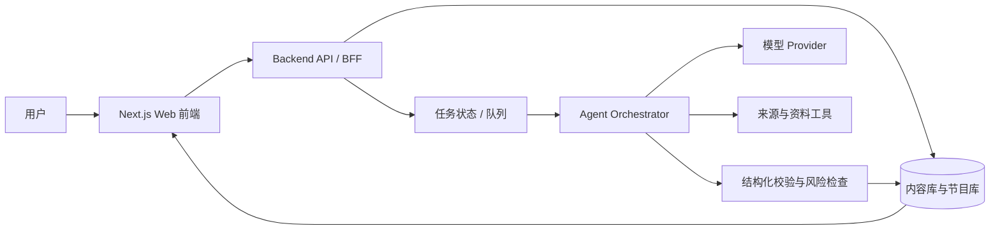

# yixi-studio 架构决策

## 结论

产品逻辑上分为前端、后端和 Agent；第一版不立即拆成三个独立微服务，而是采用模块化单体：

- Next.js 承载 Web 前端和 BFF/API
- 后端领域模块负责内容、权限、状态和持久化
- Agent 作为服务端编排模块运行
- 数据库独立，后续按生成耗时和并发量拆出队列 Worker

这样可以先跑通一条完整的内容生成链路，同时保留未来拆分边界。

## 逻辑架构



## 职责边界

### Frontend

负责：

- 首页、问题库、人物库、开一席、对谈结果和 Studio 页面
- 表单状态、加载状态、错误和重试体验
- 展示对谈轮次、来源标记和 AI 演绎声明
- 只调用后端 API，不直接访问数据库或模型 Provider

### Backend

负责：

- Topic、Question、Person、Source、EditorialBrief、Episode、Turn 等领域模型
- 鉴权、Studio 权限、参数校验和限流
- 固化问题、人物和来源快照
- Episode 状态机和持久化
- 接收 Agent 结果，做 Schema、引用和政策校验后再落库
- 后续接入搜索、TTS、分享和审核记录

### Agent

Agent 不是一个面向用户的空白聊天机器人，而是由后端触发的服务端编排器。

输入：

- 一个 Question
- 入席人物的观点卡
- 来源快照
- EditorialBrief
- 禁止断言和节目结构
- Prompt / model 版本

处理阶段：

1. 整理问题背景与人物讨论角度
2. 生成节目结构和追问顺序
3. 生成逐轮对谈
4. 为每轮标注 `fact`、`quote`、`summary` 或 `synthetic`
5. 检查来源、禁止断言、人物边界和 AI 演绎声明
6. 输出严格结构化结果

Agent 输出不直接对用户发布，必须由 Backend 校验并保存。

## Episode 状态

从第一版开始预留异步状态：

```text
pending
  → researching
  → drafting
  → reviewing
  → published

任意阶段 → failed
```

第一版可以同步执行以降低复杂度，但前端契约应按状态展示；当生成耗时或并发增加时，再把 Agent 拆成队列消费者，不改变页面契约。

## MVP 目录方向

当前仓库先保留根目录 Next.js 结构，下一步按职责增加模块：

```text
app/                       # Next.js 页面与 API Route
components/                # 前端组件
server/domain/             # 领域模型与状态机
server/repositories/       # seed / database repository
server/agents/             # orchestrator、provider、prompts、validators
lib/                       # 前后端共享类型与工具
docs/                      # 产品和架构决策
```

## API 草案

- `GET /api/topics`
- `GET /api/topics/:slug`
- `GET /api/people`
- `GET /api/people/:slug`
- `POST /api/episodes`：创建 pending Episode
- `POST /api/episodes/:id/generate`：触发 Agent
- `GET /api/episodes/:id`：读取结果和状态
- `GET /api/episodes/:id/stream`：后续支持进度流
- `POST /api/studio/*`：内部内容维护和审核

## 数据边界

- 热点内容必须有 `asOfDate` 和 `expiresAt`
- 经典内容必须有出处、时代背景和复核记录
- 每次生成保存 `sourceSnapshotId`、`promptVersion` 和 `model`
- 每轮对话保存 `provenance` 和 `citationIds`
- 所有结果固定显示“基于公开资料的 AI 演绎，非本人发言，不代表本人观点”
